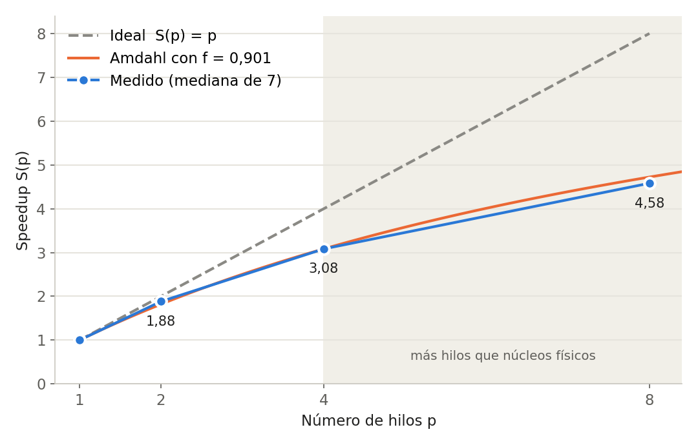

# Integración por Monte Carlo en memoria compartida con OpenMP

Estimación de π por el método de Monte Carlo (acierto y fallo), paralelizada con OpenMP en C.
Taller de Introducción a la Programación Paralela, Universidad Industrial de Santander, 2026-2.

La idea: se lanzan N puntos al azar en el cuadrado [0, 1] × [0, 1] y se cuentan los que caen dentro
del cuarto de círculo x² + y² ≤ 1. La proporción tiende a π/4, así que π ≈ 4 · dentro / N.

## Resultados principales

Con N = 10⁸ y la semilla 20261018, el programa da **π ≈ 3,141633**, con un error de 4,07 × 10⁻⁵,
menor que el error típico esperado de 1,64 × 10⁻⁴. El conteo de aciertos es **78 540 833**
con 1, 2, 4 y 8 hilos, igual al del programa secuencial: el resultado no depende del número de hilos.

Mediana de 7 ejecuciones en un AMD Ryzen 5 3450U (4 núcleos, 8 hilos), Ubuntu en WSL, gcc 15.2.0:

| Hilos p | Mediana T(p) [s] | Speedup S(p) | Eficiencia E(p) |
|:-:|:-:|:-:|:-:|
| 1 | 1,2443 | 1,000 | 1,000 |
| 2 | 0,6610 | 1,882 | 0,941 |
| 4 | 0,4036 | 3,083 | 0,771 |
| 8 | 0,2716 | 4,581 | 0,573 |



Despejando la ley de Amdahl con S(4) se obtiene f = 0,901. La caída de eficiencia se explica sobre todo
porque el procesador baja su frecuencia cuando trabajan más núcleos (3136 MHz con 1 hilo, 2539 MHz con 8)
y, con 8 hilos, porque cada núcleo físico atiende dos hilos (hiperprocesamiento).

## Cómo se paralelizó

El ciclo del programa secuencial se conserva igual. Las N muestras se dividen en bloques de 100 000
y OpenMP reparte los bloques entre los hilos:

```c
#pragma omp parallel for reduction(+:dentro) schedule(static)
for (long b = 0; b < nbloques; b++) {
    unsigned int estado = saltar(semilla, b * BLOQUE * 6);
    /* el mismo ciclo del programa secuencial, sobre las muestras del bloque b */
}
```

- `reduction(+:dentro)`: cada hilo cuenta sus aciertos en una copia propia y al final se suman.
- `saltar`: `rand_r` es un generador congruencial lineal (s ← 1103515245·s + 12345 mod 2³²).
  Esta función calcula, en O(log k) pasos, el estado que tendría el generador después de k pasos.
  Así, cada bloque arranca exactamente donde estaría el programa secuencial, los flujos de números
  no se solapan y el resultado es el mismo para cualquier número de hilos.
- Al arrancar, el programa comprueba que `saltar` coincide con `rand_r` de la biblioteca instalada.
  También avisa si N supera unos 7,2 × 10⁸, porque ahí el generador repetiría su secuencia.

## Estructura

```
Parte_II/                     Implementación en OpenMP
  codigo/
    montecarlo_ref.c          programa secuencial del enunciado, sin cambios
    montecarlo_secuencial.c   el mismo, con medición de tiempo (omp_get_wtime)
    montecarlo.c              versión paralela final
    pruebas/                  versiones incorrectas a propósito, para mostrar cada error:
      rand_global.c             todos los hilos usan rand() (estado global compartido)
      estado_compartido.c       estado de rand_r compartido sin protección
      misma_semilla.c           cada hilo con su generador, pero con la misma semilla
      sin_reduccion.c           acumulador sin reduction (condición de carrera)
      default_none.c            hace que el compilador nombre las variables compartidas
      semillas_hilos.c          muestra dónde empieza el flujo de cada hilo y lo verifica
    compilar.sh, ii1_*.sh … ii4_*.sh   compilan y ejecutan cada tarea (II.1 a II.4)
  resultados/                 salidas en texto de cada script
  evidencias/                 capturas de la terminal mientras se ejecutaban

Parte_III/                    Evaluación de desempeño: speedup y ley de Amdahl
  codigo/
    montecarlo.c, montecarlo_secuencial.c   copias idénticas de los de la Parte II
    tiempos.sh                7 rondas intercaladas con p = 1, 2, 4, 8: medianas, S, E, f y Karp–Flatt
    sobrecosto.c, .sh         costo de crear los hilos, de una región paralela y de la reducción
    frecuencia.ps1, carga.sh  frecuencia real del procesador con 1, 2, 4 y 8 hilos (Windows + WSL)
    precision.sh              efecto de aumentar p frente a aumentar N
    analisis.py               gráfica de speedup a partir de resultados/tiempos.txt
  resultados/, evidencias/
```

## Cómo ejecutarlo

Requisitos: Linux o WSL, `gcc` con soporte de OpenMP y `bash`. La gráfica necesita Python 3 con
`matplotlib`. La medición de frecuencia necesita Windows con WSL.

```bash
# Compilar
gcc -O2 -fopenmp Parte_II/codigo/montecarlo.c -o montecarlo -lm

# Ejecutar: muestras, hilos (opcional) y semilla (opcional, por defecto 20261018)
./montecarlo 100000000 4
OMP_NUM_THREADS=8 ./montecarlo 100000000
```

Salida de ejemplo:

```
p=4 N=100000000 dentro=78540833 pi=3.141633 |error|=4.07e-05 T=0.4036 s
```

Para repetir las pruebas y mediciones:

```bash
bash Parte_II/codigo/compilar.sh          # compila todo lo de la Parte II
bash Parte_II/codigo/ii1_secuencial.sh    # II.1 (también ii2_paralelo.sh, ii3_rand.sh, ii4_comparticion.sh)

bash Parte_III/codigo/compilar.sh         # compila la Parte III y muestra lscpu
bash Parte_III/codigo/tiempos.sh          # tabla de tiempos, speedup y eficiencia
python Parte_III/codigo/analisis.py       # gráfica de speedup
```

Los tiempos dependen del equipo y de su estado (con o sin cargador, otros programas abiertos).
El conteo de aciertos, en cambio, debe salir siempre 78 540 833 con N = 10⁸ y la semilla 20261018.

## Equipo

Miguel Angel Parada Rodríguez · Sebastián Villamizar Saavedra · David Steven Anaya González ·
Sergio Andrés Pinzón Castellanos · Nancy Liliana Saenz Moreno

El uso de herramientas de inteligencia artificial generativa está declarado en la bitácora de IA del informe.
